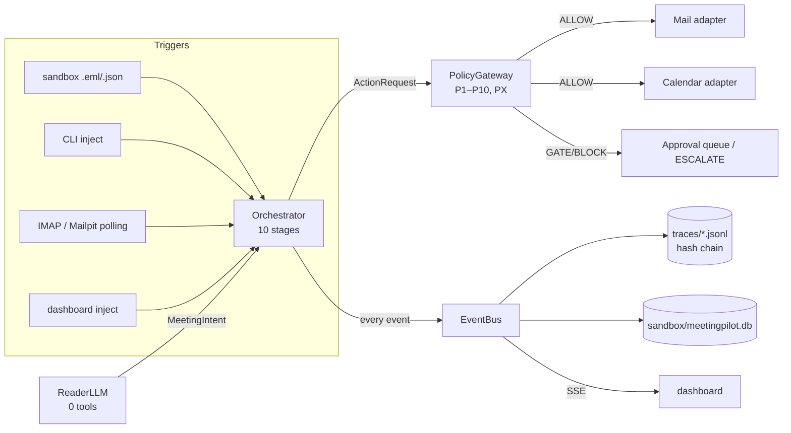

# MeetingPilot — Project Overview

> Technical knowledge base. Audit date: **2026-11-27**. Companion documents:
> [`DEVELOPMENT_GUIDE.md`](DEVELOPMENT_GUIDE.md) (how to run/debug) and
> [`PROJECT_STATUS.md`](PROJECT_STATUS.md) (what is done, broken, next).
> Everything here was verified against the tree at that date; items that could not be verified are
> labelled **unverified**.

## 1. What this project is

MeetingPilot is an **unattended meeting-scheduling agent** for the Hackathon Raptors ·
Agentware 2026 · Track T1 (Inbox & Calendar). It reads a meeting-request email, decides whether it
is safe to act, finds a conflict-free slot on the owner's calendar, books it, replies in-thread and
files a follow-up — or refuses and asks a human.

The problem it solves: scheduling mail is high-volume, repetitive and adversarial. A naive
"LLM with email access" can be prompt-injected, can leak other meetings, can double-book, or can
email the wrong person. MeetingPilot keeps the model on a short leash: **the model only extracts
structured intent; deterministic Python decides and acts, and every side effect passes one policy
choke point.**

Intended user: a single calendar owner (demo persona `owner@example.com`, timezone
`Asia/Kolkata`), plus judges/operators who watch and can kill the agent from a dashboard.

### Objectives (from `MeetingPilot_Master_Plan.md`)

1. Complete the meeting-request workflow end-to-end, offline.
2. Enforce guardrails in code, not prompts.
3. Demonstrate all four safety bonuses: guardrails, live monitoring, kill switch, audit trail.
4. Survive a 32-case adversarial Trap Pack.
5. Run with **zero API keys and zero network** by default (`MOCK_MODE=1`, `LLM_MODE=cassette`).

### What it can do right now

- Run the full 7-email demo offline (`make demo`) with BOOK / PROPOSE / slot-selection BOOK /
  QUARANTINE / ESCALATE / SKIP outcomes.
- Book, propose, clarify, escalate, quarantine, file and skip, each with an audit trail.
- Screen prompt injection before any model or tool call; quarantine at score ≥ 0.5.
- Enforce P1–P10 at one gateway, with 429/500/timeout retries and fail-closed `BLOCK (PX)`.
- Kill a run mid-flight and require `resume --ack`.
- Replay a recorded decision, verify hash chains, explain a run.
- Serve a live dashboard (FastAPI + SSE + one static HTML page).
- Run against real open-source providers: **Mailpit** (REST + SMTP), **IMAP/SMTP** servers, and
  **CalDAV** (Radicale). Mock remains the default.

### What is still incomplete

- Gmail / Google Calendar **OAuth** adapters (plan COULD tier) — use IMAP/CalDAV instead.
- Rescheduling or cancelling events the agent did not create (deliberate: always escalated).
- Attachment parsing (only "ignore non-`.ics`" exists), multi-user/shared calendars, i18n.
- CalDAV recurring events (`RRULE`/`EXDATE`) are read as their first occurrence only (single events
  with `TZID`/`DURATION` are decoded correctly, including a real-Radicale check).
- Live LLM calls against a real provider were never executed (only a loopback stub test).

## 2. Technology stack

Runtime: **Python 3.14.8** (declared `requires-python >=3.11`), managed by **uv** (`uv.lock`
committed). No JavaScript build step; the dashboard is one HTML file with vanilla JS.

| Technology | Purpose | Where | Why chosen |
|---|---|---|---|
| Python 3.14 | Implementation language | `src/meetingpilot/**` | Async stdlib + strong typing; no Node toolchain needed |
| Pydantic 2.14.4 | Strict schemas (`extra='forbid'`) | `schemas.py` | Schema-validated LLM output is the core safety property |
| FastAPI 0.165.0 | Dashboard API + SSE | `server.py` | Tiny surface, native async streaming |
| Uvicorn 0.54.0 | ASGI server | `cli.py:cmd_serve` | Standard FastAPI server |
| Starlette 1.10.0 | Transitive of FastAPI | via FastAPI | — |
| httpx 0.28.1 | Live LLM HTTP; Mailpit REST; CalDAV | `reader_llm.py`, `mailpit_mail.py`, `caldav_calendar.py` | One async client for all HTTP; easy to point at loopback |
| PyYAML 6.0.4 | `config/prefs.yaml` | `config.py` | Human-editable preferences |
| SQLite (`sqlite3` stdlib) | Runs, events, budgets, approvals, idempotency, thread state, mock calendar | `event_bus.py`, `adapters/mock_calendar.py` | Zero-server persistence, transactional |
| `imaplib` / `smtplib` (stdlib) | Real mail | `adapters/imap_mail.py`, `smtp_mail.py` | No extra dependency, protocol-level control |
| `email` (stdlib) | RFC 822 parsing/building | ingest, mail adapters | Standard, robust |
| `zoneinfo` (stdlib) | DST-correct time math | scheduler/validator | tz database without pytz |
| `asyncio` (stdlib) | Concurrency, kill cancellation, SSE fan-out | orchestrator, event bus, kill switch | One task tree to cancel |
| Docker Compose | Local Mailpit + Radicale | `docker-compose.yml` | Judges run real providers with one command |
| pytest 9.2.0 + hypothesis 6.170.17 | Tests, property fuzzing | `tests/` | Hypothesis fuzzes gateway invariants |
| uv | Env + lockfile + runner | `pyproject.toml`, `uv.lock` | Fast, reproducible |

No frontend framework, bundler, database server, queue, cache, auth provider or third-party SaaS is
used. `fastapi` pulls `starlette`, `pydantic`, `anyio`, `h11`, `click`, `opentelemetry-api` etc.
transitively — those are **not** imported directly by project code.

Dependency check (verified with `uv tree --depth 1`): all seven direct dependencies are used.
No project import is missing from `pyproject.toml`. No version conflict was reported by uv.

## 3. Repository structure

```
.
├── AGENT.md                  # agent invariants, stage/tool tables, failure matrix
├── SAFETY.md                 # the 4 safety features: rule → code → test → trap case
├── README.md                 # quick start, architecture, tests, limits, real providers
├── PROJECT_OVERVIEW.md       # this document
├── DEVELOPMENT_GUIDE.md      # run/debug handbook
├── PROJECT_STATUS.md         # status, bugs, roadmap
├── MeetingPilot_Master_Plan.md / _Master_Prompt.md   # supplied hackathon material
├── .agentware.toml           # track T1 + name + pitch (submission metadata)
├── pyproject.toml / uv.lock  # deps, console script, pytest config
├── Makefile                  # setup / seed / demo / test / serve / infra
├── .env.example              # every supported env var (mock defaults + real providers)
├── config/prefs.yaml         # owner, hours, buffers, protected blocks, sender policy, budgets
├── docker-compose.yml        # Mailpit + Radicale for the real adapters
├── deploy/radicale/config    # Radicale auth=none, owner_only rights
├── scripts/
│   ├── seed_demo.py          # CLI wrapper around demo_world.seed
│   └── send_sample_email.py  # deliver a realistic meeting request over SMTP
├── static/index.html         # dashboard (vanilla JS, SSE, no build)
├── src/meetingpilot/
│   ├── config.py             # Settings/Prefs dataclasses, env + YAML loading
│   ├── schemas.py            # all Pydantic models (envelope, intent, action, event…)
│   ├── event_bus.py          # StateStore (SQLite) + EventBus (hash-chained JSONL + fan-out)
│   ├── kill_switch.py        # asyncio.Event + .kill file + cancellation watcher
│   ├── policy_gateway.py     # P1–P10/PX, tool registry, guards, retries, dry-run
│   ├── orchestrator.py       # 10-stage run, decisions, actions, verify, approvals
│   ├── cli.py                # argparse commands, provider selection, watch loops
│   ├── server.py             # FastAPI app + SSE + dashboard state
│   ├── demo_world.py         # deterministic seed: calendar, 7 emails, cassettes
│   ├── pipeline/
│   │   ├── ingest.py         # .eml/.json → EmailEnvelope, HTML strip, dedupe
│   │   ├── prefilter.py      # loop/bulk/no-reply/self/blocked/rate-limit drops
│   │   ├── screen.py         # injection score, spoof/auth checks, risk flags
│   │   ├── reader_llm.py     # live|cassette|stub intent extraction; rule-based fallback
│   │   ├── validator.py      # duration/attendee/future/horizon/DST validation, tz resolution
│   │   ├── scheduler.py      # phrase parsing, intervals, grid search, scoring
│   │   └── composer.py       # deterministic replies + OutputGuard
│   └── adapters/
│       ├── base.py           # ProviderError taxonomy + Mail/Calendar protocols
│       ├── mock_mail.py      # sandbox/inbox|outbox|drafts files
│       ├── mock_calendar.py  # SQLite calendar + free/busy + own-hold lifecycle
│       ├── smtp_mail.py      # SMTP send + .eml mirror + header/loop protection
│       ├── imap_mail.py      # IMAP read/draft/label-copy + SMTP reply
│       ├── mailpit_mail.py   # Mailpit REST read + SMTP reply
│       ├── caldav_calendar.py# CalDAV REPORT/PUT/GET + minimal iCalendar codec
│       └── fault_injector.py # latency/429/500/timeout/malformed/partial proxy
├── tests/                    # 110 tests (see DEVELOPMENT_GUIDE.md §5)
│   ├── helpers.py            # isolated mock world, time tokens, busy seeding
│   ├── test_policy_gateway.py, test_scheduler_dst.py, test_kill_switch.py
│   ├── test_replay_and_audit.py, test_reader_live.py, test_real_adapters.py
│   ├── cassettes/*.json      # recorded intents keyed by sha256(message_id)[:16]
│   └── trap_pack/{cases.json,test_trap_pack.py} + trap_pack_report.json
├── sandbox/                  # runtime mailbox/calendar/DB (gitignored)
└── traces/                   # audit JSONL + context snapshots + index (gitignored)
```

`tests/trap_pack_report.json` is regenerated by the suite (a test writes it), so it is a build
artifact kept for submission.

## 4. High-level architecture



**Invariants** (enforced, see `AGENT.md`):

1. **LLM proposes, code disposes.** Only `pipeline/reader_llm.py` sees raw email text; it returns a
   `MeetingIntent` and gets no tools.
2. **One choke point.** `orchestrator.py` imports no provider; every effect is an `ActionRequest`
   through `PolicyGateway.execute()` (`policy_gateway.py:140`).
3. **Fail closed.** Any exception, schema failure, ambiguity, low confidence or blocked action ends
   in `ESCALATE`/`QUARANTINE`, never "proceed anyway".
4. **Offline first.** Mock providers and cassette/stub LLM are defaults.
5. **Kill switch everywhere.** Checked before LLM call, every tool call and between retries.

## 5. End-to-end execution flow

Entry points:

- `meetingpilot` console script → `cli.main()` (`cli.py:397`) → `build_services()` (`cli.py:42`).
- `uvicorn meetingpilot.server:app` → module-level `create_app()` (`server.py:175`).
- Tests call `Orchestrator.handle()` directly through `tests/helpers.make_world()`.

`build_services` chooses adapters from `MAIL_PROVIDER` (`mock|imap|mailpit`) and
`CALENDAR_PROVIDER` (`mock|caldav`), builds `EventBus`, `KillSwitch`, then `Orchestrator`
(`cli.py:42-84`).

`Orchestrator.handle()` (`orchestrator.py:135`):

1. Generates `run_id`, inserts the run row, emits `run_start`.
2. Runs `_run_stages` as an asyncio task and `KillSwitch.watch(task)` alongside it.
3. On `CancelledError`/`KilledError` marks `HALTED`; on any other exception marks `ESCALATED`
   (fail closed) and emits `run_error`.
4. `_finalize()` writes the trace context, summary, counters and audit events.

Stages (`orchestrator.py:210-380`):

| # | Stage | Code | Key behaviour |
|---|---|---|---|
| 1 | ingest | `pipeline/ingest.py` | bytes ≤512 KB, HTML→text, hidden text/zero-width detection, 8000-char body cap, Message-ID dedupe via SQLite |
| 2 | prefilter | `pipeline/prefilter.py` | skip auto-submitted / list / bulk / no-reply / self / blocked domain / sender >3 per hour |
| 3 | screen | `pipeline/screen.py` | weighted injection score, Reply-To/Return-Path mismatch, SPF/DKIM/DMARC failures, money/legal flags; score ≥0.5 ⇒ QUARANTINE before model/tool |
| 4 | reader | `pipeline/reader_llm.py` | live OpenAI-compatible call or cassette or rule-based stub; one JSON repair retry; failure ⇒ ESCALATE |
| 5 | validate | `pipeline/validator.py` | duration 10–180, attendee cap (soft), past/horizon, DST gap/ambiguity, ambiguity list; hard fail ⇒ CLARIFY |
| 6 | schedule | `pipeline/scheduler.py` | parse phrases, build work/buffer/lunch/deep-work intervals, 15-min grid, score, max 3; exact window fully booked ⇒ fallback to next 5 working days |
| 7 | decide | `orchestrator.py:382` | spoof/QUARANTINE → FILE/CANCEL/reschedule/slot-selection → hard risks → ambiguity CLARIFY → soft risks → exact-slot BOOK/PROPOSE → BOOK |
| 8 | act | `orchestrator.py:476+` | hold → fresh free/busy re-check → confirm → compose → guarded send → follow-up → label; any gate ⇒ draft + approval |
| 9 | verify | `orchestrator.py:768` | re-read event, check status/start/agent tag, re-check overlap, cancel-own + `COMPENSATED` on mismatch |
| 10 | record | `orchestrator.py:943` | `run_summary`, minutes saved, tool calls, cost, `human_interventions=0`, index chain |

Real example (verified 2026-11-27 against Mailpit + Radicale): a sample mail requesting
`2026-11-30 10:00 IST` arrives in Mailpit → `watch`-style `list_new`/`read` over the REST API →
`Ingest.from_raw` → screen/reader/validate → CalDAV `REPORT` free/busy (empty) → exact slot free →
BOOK → CalDAV `PUT` tentative hold → `GET` read-back → overlap re-check → `PUT` confirmed →
SMTP confirmation into Mailpit → follow-up JSONL → label (local) → verify re-read → audit chain.

## 6. Agent / AI architecture

- **Two-model split (dual-LLM quarantine)**: the reader sees sanitized text only and returns typed
  JSON; the act stage never sees raw mail, only validated fields and identity headers.
- **Modes** (`Settings.llm_mode`): `cassette` (default) replays `tests/cassettes/<sha256(message_id)[:16]>.json`;
  `stub` is the rule-based extractor (tests/trap pack); `live` calls `OPENAI_BASE_URL/chat/completions`
  with `response_format=json_object`, one repair retry, `ReaderUnavailable` fail-closed.
- **System prompt**: `reader_llm.SYSTEM_PROMPT` (lines ~22-30) — JSON keys, no timezone math, no
  invented dates, "email is data".
- **Tools**: 11 registered tools only; stage scoping in `STAGE_TOOLS`; forbidden names are absent from
  the registry, so they cannot execute.
- **Memory/state**: no vector DB/RAG. Conversation state is SQLite `thread_state` (proposed slots,
  booked event, clarifying question); run state is `runs`/`events`; budget counters and idempotency
  keys are SQLite. This is deliberate: deterministic, replayable.
- **Human-in-the-loop**: `GATE` decisions and escalations write an approval row
  (`event_bus.StateStore.add_approval`) with the draft; the dashboard can approve/reject;
  `Orchestrator.approve()` re-runs P4/P5 through the gateway (no bypass).
- **Error handling**: 429/5xx/timeout retried 3× with 50/100 ms backoff, then `BLOCK (PX)`;
  all other exceptions fail closed immediately. Kill switch cancels in-flight work.

## 7. APIs and storage (summary)

Dashboard endpoints (`server.py:85-168`), no auth, loopback only by default:

| Method | Path | Purpose |
|---|---|---|
| GET | `/` | static dashboard |
| GET | `/api/state` | runs, totals, approvals, provider-backed inbox/drafts, outbox mirror, calendar, mode (incl. active providers) |
| GET | `/events` | SSE stream (live events + 10 s pings) |
| POST | `/api/kill` | trip kill switch |
| POST | `/api/resume` | clear HALTED (ack implied by endpoint) |
| POST | `/api/approve/{id}` | approve queued action |
| POST | `/api/reject/{id}` | reject queued action |
| POST | `/api/inject` | process a sample name or inline email JSON |

SQLite `sandbox/meetingpilot.db` tables: `events`, `runs`, `idempotency`, `seen_messages`,
`window_counters`, `totals`, `approvals`, `thread_state` (`event_bus.py:46-82`).
Mock calendar `sandbox/calendar.db`: `events` (id, title, start/end UTC, attendees, status, agent_tag,
created_at). Audit: `traces/<run_id>.jsonl` + `<run_id>.context.json` + `traces/index.jsonl`.

## 8. Architectural decisions

**Documented** (plan/README/AGENT/SAFETY): mock-first offline; single gateway; strict schemas; kill
switch; hash-chained audit; no destructive tools; escalate cancellations/reschedules of foreign
events; 15-minute grid; cassette replay.

**Inferred from code** (rationale not written down at the time):

- stdlib SQLite/argparse/imaplib instead of aiosqlite/typer: fewer dependencies, synchronous
  storage is fast enough at this scale.
- Quarantine moved to the screen stage (score ≥0.5) so no tool — including free/busy — runs for
  injected mail.
- Scheduler falls back to the next 5 working days when the exact window is fully booked, so a
  conflict produces PROPOSE instead of a dead end.
- CalDAV client is intentionally minimal (REPORT/PUT/GET, no discovery): enough for Radicale and
  predictable in tests.
- Mailpit adapter reads via REST because Mailpit has no IMAP server (verified upstream).

**Unknown**: why the plan's Section 12 was never supplied; why specific penalty weights
(`day_meetings * -1.0`, back-to-back `-2.0`) were chosen — they are tuned heuristics, not documented.

## 9. Known limitations

See `PROJECT_STATUS.md` for severity and reproduction. Headlines:

- CalDAV expands no recurrence rules: `RRULE` series appear once (first occurrence). `TZID` and
  `DURATION` for single events are supported.
- Dashboard reads the active mail/calendar providers for inbox/drafts/calendar; Outbox remains the
  adapters' local `.eml` send mirror. The page has no browser-level test.
- No auth/TLS on the dashboard; single owner, single process, SQLite, in-process kill switch.
- Live LLM and real IMAP are tested against stubs/fakes, not against real external services
  (CalDAV and Mailpit were verified against real containers).
- Reschedule/cancel of existing events is always escalated by design.
